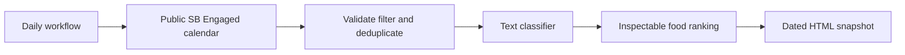

<p align="center"></p>

<h1 align="center">Freefood-Radar-SBU</h1>

<p align="center">
  <a href="https://github.com/FaiyazEnayet/freefood-radar-sbu/actions/workflows/ci.yml"></a>
  
  
  
</p>

<p align="center">
  <a href="https://faiyazenayet.github.io/freefood-radar-sbu/docs/dashboard.html"></a>
  <a href="#method"></a>
  <a href="#run-locally"></a>
</p>

Freefood-Radar-SBU reads the public SB Engaged calendar at Stony Brook University and ranks possible food opportunities. Event facts stay attached to their official source; food availability remains a model prediction.


<p align="center"><a href="https://faiyazenayet.github.io/freefood-radar-sbu/docs/dashboard.html"></a></p>


An event’s predicted food relevance and the reliability of its listing are separate considerations. The interface keeps the official source, event time, snapshot freshness and location availability close to each recommendation. A saved candidate still requires checking the organizer’s current details; the public feed does not verify that food will be available when a student arrives.

## Explore

- Search official public events, inspect source descriptions and open organizer event links.
- Filter model food candidates, all public events or locally saved events, with date filters and pagination.
- Inspect source freshness, withheld locations and historical model evaluation without confusing them with live-feed accuracy.
- See verified building locations on a map: one pin per building, with that building's events in the popup. Only buildings on a verified list get pins; events with withheld, online, or unmatched locations stay in the list without a pin.

## Method

The public ICS calendar is filtered to not-ended events in a rolling 14-day window. UID, modification and cancellation handling produce a dated source snapshot. The existing TF-IDF/logistic classifier supplies probabilities, and transparent food-quality weights supply the ranking.

## Evidence at a glance

| Scope | Recorded result or contract |
| :--- | :--- |
| Source | Official public SB Engaged calendar; no login required |
| Refresh | Daily workflow at 11:17 UTC, plus manual refresh |
| Historical labeled-text test | 40 examples; precision 89.5%; recall 85.0% |
| Live-feed validation | Food-availability precision and calibration are not yet established |

## Updating this project

Dashboard source language: **Python**. Generator: `scripts/make_dashboard.py and scripts/refresh_sbengaged.py`. The local interactive output is `docs/dashboard.html`.

## Run locally


```sh
python -m pip install -r requirements.txt
python -m pip install -r portfolio_ui/requirements.txt
python scripts/refresh_sbengaged.py --days 14
python -m pytest tests -q
```

## Technical design

The ingestion layer reads the public calendar advertised by SB Engaged. It filters a rolling time window, handles source identity and cancellation state, and records fetch provenance. Text is scored by the repository’s existing small-data classifier. The browser displays the dated snapshot and stores saved event IDs locally.



## Evaluation protocol

The original labeled-text test is separate from the public feed. Its precision and recall describe that held-out sample, not verified campus food availability. Public-source events can still be cancelled, restricted or have locations withheld behind sign-in. The UI links back to the source rather than fabricating missing details.


An official listing establishes that the event was published, not that food is free or available when a student arrives. The model probability and food-quality weight are ranking aids. Source freshness and organizer details remain necessary for a useful decision.

## Code and data

`src/radar/scrapers/sbengaged.py` parses the public calendar. `live.py` validates and scores snapshots. `data/sbengaged-status.json` records refresh health. [Integration notes](SBENGAGED-INTEGRATION.md) document the contract and daily workflow.


## Limitations

- Public coverage excludes private events and locations hidden behind university sign-in.
- The classifier was trained on a small SBU-style labeled set, not verified food outcomes from this feed.
- A downloaded HTML is a dated snapshot. Failed refreshes retain the last good source data and display the failure. No demonstration events are substituted.

## License

[MIT](LICENSE). Third-party datasets, libraries and fonts retain their own terms.
